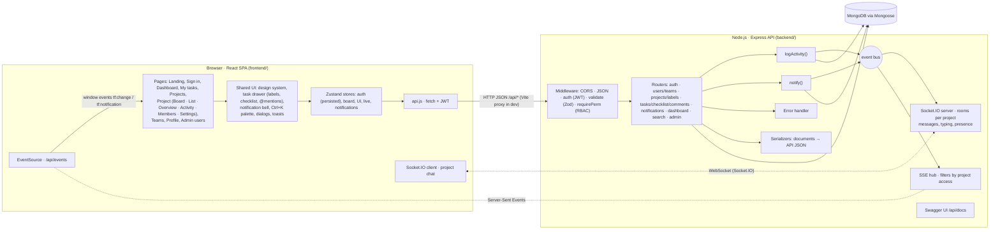

# Architecture

## Request lifecycle

1. A component calls a store action or `api()` (for example dragging a card calls `useBoard.move`).
2. The store applies an **optimistic update**, then sends the request with the JWT.
3. Express runs `auth` → `validate(zodSchema)` → `requirePerm('task:update')` → the handler.
4. The handler updates MongoDB through the Mongoose models and calls `logActivity()` once per changed field. Serializers turn documents into the API's JSON (numeric ids, snake_case fields, joined names).
5. `logActivity()` writes the history row and emits on the event bus; the SSE hub pushes `{ projectId, taskId, userId, action }` to every connected user who can see that project.
6. Other browsers receive the event and re-fetch only what is on screen (the board, the open task, the dashboard), debounced.
   If the change concerns someone personally (assignment, comment on their task, `@mention`, added to a project), `notify()` stores a notification and the hub sends `{ kind: "notification" }` to that person only. Their bell, tab title and a toast update.
7. If the request fails, the store rolls back and a toast explains why.

## RBAC model

| Permission | Minimum project role |
|---|---|
| `project:read` | viewer |
| `task:create`, `task:update`, `comment:create` | member |
| `task:delete`, `project:update`, `member:manage` | manager |
| `project:delete` | owner |

The workspace `admin` counts as `owner` everywhere. Team actions need the team `lead` role. Rules that are not just a role check are enforced too: the owner's role cannot be changed, a team always keeps a lead, the last admin cannot be demoted, and only authors can edit their comments. The frontend reads `my_role` and `can_*` flags to hide actions, but the server is the source of truth.

## Frontend structure

| Path | Contents |
|---|---|
| `src/index.css` | Design system: tokens (colours, radius, shadows), buttons, inputs, cards, tables, overlays, board, landing |
| `src/components.jsx` | Primitives: Button, Avatar, StatusIcon, PriorityIcon, Picker (custom select), Modal, Drawer, Popover, Menu, Pagination, Tabs, toasts, confirm dialog |
| `src/Layout.jsx` | App shell: sidebar, mobile navigation, realtime connection, global hosts for the task drawer and "new" dialogs |
| `src/TaskDrawer.jsx` | Task detail panel: inline field editing, description, comments, history |
| `src/CommandPalette.jsx` | Ctrl+K search and navigation |
| `src/pages/…` | One file per page; the project page's tabs live in `pages/project/` |
| `src/store.js` | Zustand stores |
| `src/hooks.js` | `useFetch`, `useLiveEvents`, `useDebounced`, `useHotkey`, `useDocumentTitle` |

## Frontend state management

- **Auth store** keeps the token and user in localStorage. A `401` signs you out with a message.
- **Board store** holds the open project's tasks, the shared filters (used by both Board and List) and the sort order. It does optimistic Kanban moves with rollback, and accepts updates from the task drawer (`upsert`) so every view stays in sync.
- **UI store** handles toasts (with undo actions), the promise-based confirm dialog, the Ctrl+K palette and the global New task / New project dialogs.
- **Live store** tracks whether the realtime connection is up; it drives the "Live updates on" indicator.
- Page data is loaded with `useFetch`, which can refresh silently when a live event arrives.
- The open task is part of the URL (`?task=12`), so task links can be shared and the back button closes the panel.

## Key design choices

- **MongoDB + Mongoose.** Collections for users, teams, projects, tasks, comments and activity; memberships are embedded in their team or project. Lists, filters and sorting run as aggregation pipelines (`$match`, `$lookup`, `$facet` for paging). See [ER_DIAGRAM.md](ER_DIAGRAM.md).
- **Runs anywhere.** Set `MONGODB_URI` for any MongoDB (local install, Docker or Atlas). Without one, `npm run db` starts the official MongoDB server through `mongodb-memory-server`, storing data in `backend/data/mongo`. Tests use a throwaway in-memory instance per test file.
- **Express 5** forwards errors from async handlers to the error handler, which also maps Mongoose validation errors to `400`.
- **Server-Sent Events** for change notifications: updates only flow server → client, SSE works over plain HTTP, and the browser reconnects on its own.
- **Socket.IO for the project chat**, because chat is two-way: sending with an acknowledgement, "is typing…" and who's online. Each project is a Socket.IO room. The socket authenticates with the same JWT, joining a room checks project access, and people who are removed from a project are taken out of its room. Chat logic lives in one service (`chat.js`) used by both the socket handlers and the REST routes, so permissions and validation can't drift apart.
- **Dark mode** is a set of CSS variable overrides on `:root[data-theme='dark']`. Components only use variables, so no component has theme-specific code. The choice (Light, Dark or System) is stored per device and applied by a tiny script in `index.html` before the first paint.
- **Validation on both sides:** the client gives instant feedback; Zod on the server is authoritative and returns per-field messages that the forms display.
- **Accessible drag and drop** with dnd-kit: mouse, touch and keyboard (Space to pick up, arrows to move, Space to drop) with screen-reader announcements.
- **One pagination envelope** everywhere: `{ data, pagination: { page, limit, total, pages } }`.
