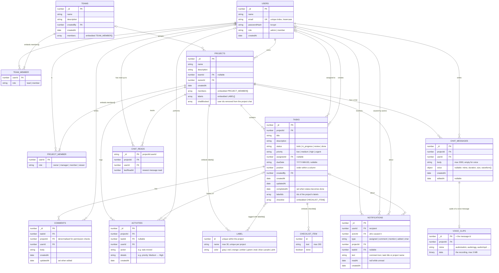

# ER Diagram (MongoDB data model)

TaskFlow stores its data in **MongoDB** through **Mongoose** schemas (`backend/src/models.js`). Ten collections hold the entities. Team and project memberships, a project's labels and a task's checklist are **embedded** in their parent document because they are small and always read together with it.

An eleventh collection, `counters`, issues the numeric ids (`{ _id: "tasks", seq: 34 }`), including the ids of labels and checklist items.

## Design notes

- **Readable numeric ids.** Documents use small sequential numbers as `_id` (issued atomically by the `counters` collection) rather than ObjectIds, so URLs stay short (`/projects/1?task=12`) and the API is identical to the earlier SQL version.
- **Embedded vs referenced.** Memberships, labels (≤ 30 per project) and checklist steps (≤ 50 per task) are small, bounded and always needed with their parent, so they are embedded. Adding a project and its members is one atomic write, and loading a board needs no extra queries for labels or checklist progress. Tasks, comments, activity entries, notifications and chat messages grow without limit and are paginated, so they live in their own collections and reference their project.
- **Two levels of roles.** `users.role` is the workspace role (admins bypass project checks). `teams.members[].role` controls who manages a team. `projects.members[].role` controls what someone can do inside one project.
- **Validation.** Mongoose schemas enforce required fields, lengths and enum values (status, priority, roles). Zod validates the same rules at the API boundary and returns per-field messages.
- **Deletes.** MongoDB has no foreign keys, so the API removes dependants explicitly. Deleting a project removes its tasks, comments, activity, notifications and chat. Deleting a label takes it off every task (`$pull`). Deleting a team keeps its projects (`teamId` becomes `null`). Deleting a task removes its comments and keeps its history entries with `taskId: null`, so the project feed still shows "deleted …". Notifications about a deleted task stay readable and show the task as gone. Removing someone from a project unassigns their tasks there.
- **Ordering.** `position` is a fractional number, so a card can be placed between two others by taking the midpoint, without renumbering the column.
- **History.** Every change writes one `activities` document per changed field, with before and after values in `details`, and publishes a realtime event.
- **Seen by** reuses the chat read markers: a message has been seen by everyone whose `lastReadId` is at least its id, so no per-message receipt documents are needed. **Removed from chat** is a list of user ids on the project (`chatBlocked`), cleared when someone leaves the project.
- **Voice messages** keep their audio in a separate `voice_clips` document (same id as the message), so loading chat history never pulls megabytes of audio; only the duration and a 40-bar waveform travel with the message. The audio is downloaded once, when someone presses play.
- **Chat read markers** (`chat_reads`) store one number per person and project, the newest message they've read, so the unread badge is a single count query (`_id > lastReadId` and not written by you). Markers only move forward (`$max`). Chat history is paged with an id cursor (`before`) rather than page numbers, so new messages arriving don't shift older pages.
- **Notifications** are written for the recipient only (never the actor), and only for people who are still project members. A label or member can't be added twice even under concurrent requests: the update itself carries the condition (`labels: { $not: { $elemMatch: … } }`).
- **Indexes.** `users.email` (unique); `teams.members.userId` and `projects.members.userId` (membership lookups); `projects.teamId`; `tasks(projectId, status, position)` for boards; `tasks(assigneeId, status)` for My tasks; `comments(taskId)`; `activities(projectId, createdAt)` and `activities(taskId, createdAt)` for feeds; `notifications(userId, createdAt)` and `notifications(userId, readAt)` for the bell; `chatmessages(projectId, _id)` for chat history and unread counts.
