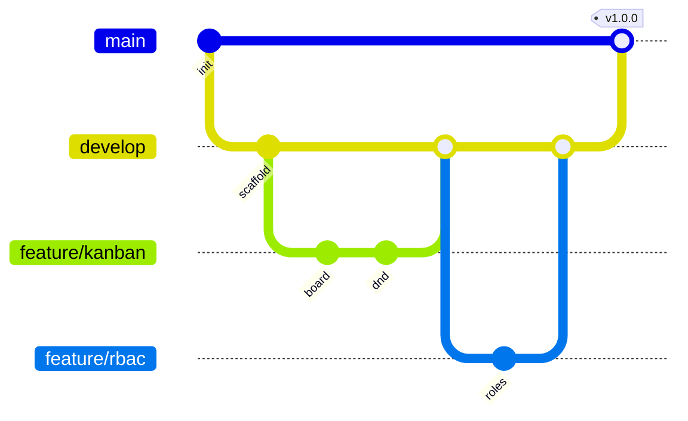

# Git Branching Strategy

Simplified Git Flow:

| Branch | Purpose |
|---|---|
| `main` | Production-ready, tagged releases |
| `develop` | Integration branch |
| `feature/<name>` | New features, branched from `develop` |
| `fix/<name>` | Bug fixes |
| `hotfix/<name>` | Urgent fixes branched from `main` |

Rules: PRs into `develop` require passing `npm test` + review. Conventional commits (`feat:`, `fix:`, `docs:`, `test:`).
